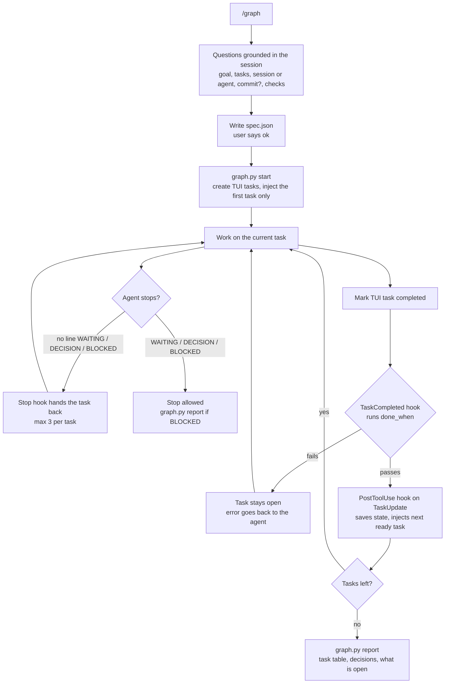
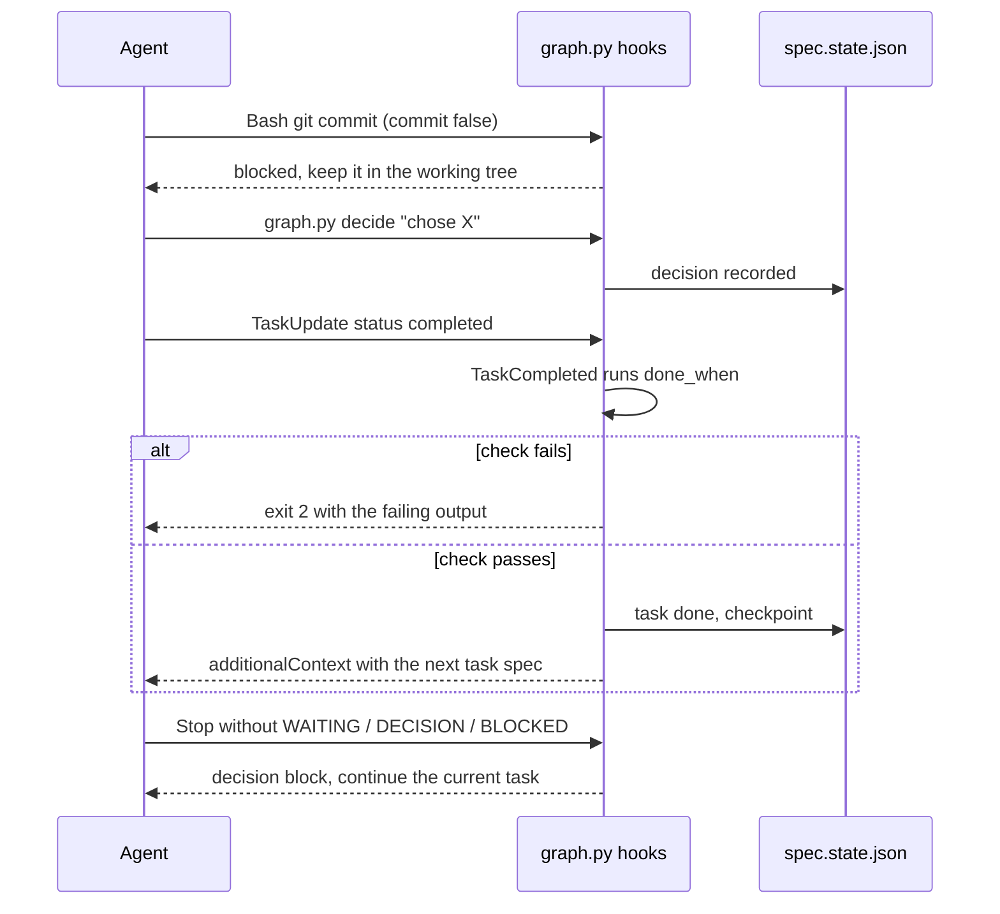

# skills

Claude Code skills I use every day.

## graph

Runs a long job as a graph of tasks written in a spec, one task at a time:

- `/graph` asks a few questions using what the session already knows, writes the spec as JSON and creates the tasks in the TUI.
- Only the current task's spec is injected. The rest is a list of titles until it is their turn.
- Marking a task completed runs its `done_when` commands in a `TaskCompleted` hook. A failure keeps the task open and sends the output back. A pass injects the next task's spec through a `PostToolUse` hook on `TaskUpdate`.
- A `Stop` hook hands the current task back when the agent stops without saying why. It may stop with `WAITING:` (CI, build, deploy), `DECISION:` (a question for you) or `BLOCKED:`.
- With `commit: false`, a `PreToolUse` hook blocks `git commit`, `git push`, `gh pr create` and `gh pr merge` while the graph is active.
- Each task can run in the session or be delegated to one agent.
- `graph.py decide` records every choice the agent made without being asked, and `graph.py report` prints a table of the tasks, those decisions and what is still open, at the end or when the graph is blocked.

### Flow



### One task, hook by hook



The state file next to the spec is the checkpoint, so `start` resumes where it stopped. The ideas come from LangGraph (state, nodes, edges, checkpoints, interrupts) and from the harness engineering write-ups by Anthropic, OpenAI and Mitchell Hashimoto.

### Install

```bash
git clone https://github.com/HugoluizMTB/skills.git
mkdir -p ~/.claude/skills && cp -r skills/graph ~/.claude/skills/
```

Needs Python 3 and a Claude Code version with skill hooks and the `TaskCompleted` hook event.
